<picture>
  <source media="(prefers-color-scheme: dark)" srcset=".github/assets/isoatlas-banner-dark.svg">
  
</picture>

    <h1>isoAtlas</h1>
    <h4>A React component for drawing network diagrams.</h4>

## About

Isoatlas is a community fork of [Isoflow](https://github.com/markmanx/isoflow), whose
development stopped in 2024. It is maintained independently and is **not affiliated with,
nor endorsed by, the authors of Isoflow**. The original work is distributed under the MIT
license, which this fork preserves.

The fork exists to keep the project alive: dependencies are kept current, security issues
are addressed, and new features are welcome.

## Key features
- **Drag-and-drop editor** - Express your architecture with icons, regions and connectors.
- **Extensible icon system** - Create your own icon library, or use plugins for existing libraries including AWS, Azure, GCP, Kubernetes, and more.
- **Export options** - Export diagrams as code or images.

## Quick start

Install it from npm, along with the icon packs it uses:

- `npm install isoatlas @isoflow/isopacks`

Read the [documentation](https://enixcode.github.io/isoatlas/docs/) or try the [live demo](https://enixcode.github.io/isoatlas/).
The documentation sources live in [`docs/`](./docs).
